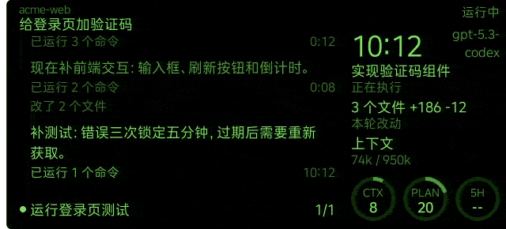

# QwenGlass-Codex：在千问 AI 眼镜上看 Codex Desktop 干活，用语音给它发指令

> 非官方个人项目，与 OpenAI、Codex、阿里巴巴、通义千问及千问 AI 硬件开放平台没有关联。


[](LICENSE)



<sub>实时进度 → 菜单 → 计划与改动 → 切换任务 → 语音草稿 → 完成回复。画面在本地模拟器里渲染，模拟器和千问开放平台的页面预览使用同一个渲染内核；任务和项目都是虚构的。</sub>

电脑上正在跑的 Codex Desktop 任务，在眼镜上能看到它做到哪一步、改了哪些文件、计划进行到哪里、上下文用了多少；对着眼镜说一句话，单击确认后就送进原来那个桌面任务，不另起一个 Codex 进程。

## 能做什么

| | |
|---|---|
| 选任务 | 列出 Codex Desktop 最近任务、工作区和状态：运行中、失败、已完成 |
| 看回复 | 回复按眼镜原生字体分页，镜腿滑动立即翻页 |
| 看进度 | 左边是时间流：文字、命令组、文件改动；右边是总用时、当前计划、改动统计、上下文和三个圆环 |
| 看计划 | 单独的“计划与改动”页，显示步骤状态和本轮文件改动 |
| 语音发指令 | 说的话先变成草稿，单击才发送；取消就滑动 |
| 快捷回复 | 不用开口，菜单里选「继续」「好的，就这么做」「先停一下」「说简单点」 |
| 调字号 | 菜单里调回复和进度的字号，16 到 24 |

## 重要限制

- **只接已经在 Codex Desktop 里打开的任务。** 不会偷偷新建任务，也不会启动 CLI；任务没在桌面界面打开时，发送会明确失败。
- 只同步当前选中的一轮，不同步整份历史。
- 暂不支持在眼镜上批准命令或文件改动；需要批准时回电脑处理。
- 只验证了 macOS。Windows 和其它系统没测过。
- Codex Desktop 的数据库、回放文件和 IPC 都不是公开稳定 API；桌面版升级后可能需要跟着改。
- 写入路径和页面已在本地模拟器、假 IPC 和本机只读链路上验证；真实发送到桌面任务和真机使用仍要先做一次小范围测试。

## 怎么工作

```text
千问眼镜
  ↓ 语音、页面、按键
千问开放平台
  ↓ wss /agent
云端服务 glasscodex serve
  ↑ wss /bridge
Mac 桥接程序 glasscodex bridge
  ├─ 只读 ~/.codex/state_5.sqlite、thread_history_1.sqlite、sessions/*.jsonl
  └─ 通过 ~/.codex/ipc/ipc.sock 请求桌面版已有的任务所有者开始新一轮
```

平台不能直接访问你的 Mac，所以需要一台公网云端；Mac 上的桥接程序主动连出去，电脑不用开端口。

桥接程序只把眼镜当前选中的任务文字发上云。文字离开 Mac 前会折叠代码块、隐藏常见密钥；云端不保存任务历史，只保留当前状态。

## 准备

- 一台 macOS 电脑，装有 Codex Desktop，并能正常运行任务。
- Python 3.12 和 [uv](https://docs.astral.sh/uv/)。
- 一台公网服务器，有真实证书的 HTTPS 域名，装好 Docker，或者能自己配反向代理。
- 千问开放平台账号，已开通「Agent 自定义接入」。
- 一副千问 AI 眼镜 S1。

## 一、部署云端

1. 复制配置并生成两个不同的 Token：

   ```bash
   cp .env.example .env
   openssl rand -hex 24
   openssl rand -hex 24
   ```

   `GLASSCODEX_AGENT_TOKEN` 给千问平台，`GLASSCODEX_BRIDGE_TOKEN` 给 Mac。不要把两者写成同一个。

2. 启动容器：

   ```bash
   cd deploy
   docker compose up -d --build
   ```

   服务只监听 `127.0.0.1:19520`，不存数据，内存上限 128 MB，根文件系统只读。

3. 把 `deploy/site.conf` 合进你已有的 HTTPS 站点。它把 `/codex/` 转发到本机服务，并允许 WebSocket 长时间连接。检查：

   ```bash
   curl https://example.com/codex/healthz
   # {"ok":true}
   ```

## 二、在 Mac 上运行桥接程序

```bash
uv sync
export GLASSCODEX_CLOUD=wss://example.com/codex/bridge
export GLASSCODEX_BRIDGE_TOKEN=和服务器 .env 里同一个
uv run glasscodex doctor
uv run glasscodex bridge --keep-awake
```

`doctor` 会检查桌面版数据库，并只读确认最近任务是否在桌面界面打开，不会发送内容。桥接程序运行时电脑不能休眠；合盖会断。

要用命令行看一个任务：

```bash
uv run glasscodex threads
uv run glasscodex turn <task-id>
```

## 三、在千问开放平台配置

发布按钮只由你本人按；只自己用时，草稿和真机测试就够了。

1. 新建「Agent 插件」，Agent 平台选「自定义接入」。
2. WebSocket 地址填 `wss://example.com/codex/agent`。
3. 认证选 Bearer Token，填 `GLASSCODEX_AGENT_TOKEN`。
4. 通信方式选「ASR文本」。
5. 插件名称可以用 `Codex 连接器`，描述写清楚：在眼镜上查看电脑上 Codex Desktop 的任务并发送指令，用户说“打开 Codex”“看看桌面版 Codex”“看代码任务”时使用。
6. 在关联 Skill 里新建页面 `codex-panel`：
   - 模板：`pages/codex-panel/template.xml`
   - Mock 数据：`pages/codex-panel/data.json`
   - 页面说明必须包含 `codex-panel`
7. `skill/SKILL.md` 是随仓库提供的 Agent 说明。平台如果自动生成了 Skill 文档，可以按你的平台版本替换或合并。
8. 真机测试，对眼镜说“打开 Codex”。
9. 第一次连上后，从服务日志复制设备 ID，填进 `.env`：

   ```text
   GLASSCODEX_ALLOWED_DEVICES=dev_xxx
   ```

10. 重建容器。可选：把日志里的页面 templateId 填进 `GLASSCODEX_TEMPLATE_ID`，用于平台重连时不带页面列表的情况。

## 眼镜上的操作

| 操作 | 回复 | 实时进度 | 菜单/任务列表 | 草稿 |
|---|---|---|---|---|
| 前滑 / 后滑 | 下一页 / 上一页 | 翻时间流 | 移动光标 | 取消 |
| 单击 | 打开菜单 | 打开菜单 | 选中 | 发送 |
| 双击 | 提示后再双击退出 | 同左 | 同左 | 同左 |

麦克风在技能会话里一直开着；所有识别到的话都先成为草稿，单击才发送。30 分钟没有单击或滑动，服务会结束会话。

## 安全

- 能连上这个服务的眼镜，就能向桌面版 Codex 发送文字，而 Codex 可以在电脑上执行操作。两个 Token 必须保密。
- 正式使用一定要设 `GLASSCODEX_ALLOWED_DEVICES`。设备 ID 缺失时，这项白名单拦不住。
- 云端服务不保存历史，但平台的控制台调试日志可能记录页面数据；不要把密钥、Token 或大段终端输出发进 Codex。
- 文本过滤不保证绝对不漏密钥。不要把密钥贴进对话。

## 本地开发和测试

```bash
export UV_PROJECT_ENVIRONMENT=~/.cache/glasscodex-venv
uv sync
uv run pytest -q
```

本地假平台：

```bash
export GLASSCODEX_AGENT_TOKEN=test
uv run python tools/fake_platform.py \
  --url ws://127.0.0.1:8792/agent \
  --script "wait 2; say 跑一下测试; show; send; wait 3; show"
```

页面渲染需要另一个仓库里的 waft-lite 模拟器；公开版只带已经渲染好的 `docs/demo.gif` 和 `docs/demo/*.png`。

## 目录

| 路径 | 内容 |
|---|---|
| `glasscodex/desktop.py` | 只读 Codex Desktop 数据库和回放 |
| `glasscodex/ipc.py` | 桌面版本地 IPC 客户端 |
| `glasscodex/bridge.py` | Mac 到云端的桥接 |
| `glasscodex/panel.py`、`layout.py` | 眼镜会话、分页和实时时间流 |
| `pages/codex-panel/` | 眼镜页面和 Mock 数据 |
| `skill/` | Agent 技能说明 |
| `deploy/` | Docker、Compose 和反向代理片段 |
| `tests/` | 桌面状态、IPC、页面和完整链路测试 |

## License

MIT
